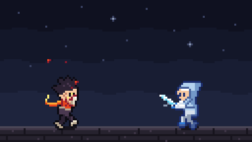

<p align="center">
  <picture>
    <source media="(prefers-color-scheme: dark)" srcset="assets/logo-wordmark-dark.png">
    
  </picture>
</p>

Atelier is an offline, headless pixel-art editor for command-line tools and AI agents. Create layered sprites and animations, inspect pixels, and export PNGs, spritesheets, GIFs, APNGs, and TrueType pixel fonts. Documents stay local.

Use it directly from a shell, or connect an agent such as Claude Code or Codex through MCP (Model Context Protocol). Both interfaces expose the same editing tools; no graphical editor or running server is needed for CLI calls.

<p align="center">
  
  
  
  
</p>

<p align="center">
  Drawn by an agent through Atelier's tools. Each is rebuilt byte for byte from
  the <a href="showcase/replays/opus-5.5-xhigh">recipe beside it</a> in CI.
</p>

<p align="center">
  A more complex design made by combining physics simulation with Atelier MCP using Opus 5.5.
  <br>
  
  <br>
  The replay file is too large to include here.
  Download it from <a href="https://drive.google.com/file/d/1dZl9sXa4SlbGT6gEoKtsmA2a4VU4oGYy/view?usp=share_link">Google Drive</a> if needed.
</p>

## Showcase

- [Animation showcase](https://marmikshah.github.io/atelier/) — compare models and briefs, view animations, and download replays.
- [Frayed](https://apps.apple.com/app/id6806894761)
- [Orbital Dodge](https://apps.apple.com/app/id6740900205)

## Install

On macOS, Ubuntu, or any other Linux, paste this into a terminal:

```sh
curl -fsSL https://github.com/marmikshah/atelier/releases/latest/download/install.sh | sh
```

Ubuntu Desktop comes without curl; use wget instead:

```sh
wget -qO- https://github.com/marmikshah/atelier/releases/latest/download/install.sh | sh
```

It downloads Atelier for your machine, checks it, puts it in `~/.local/bin`, and adds that to your `PATH`. If Claude Code or Codex is installed, it also connects Atelier to them: they get its drawing tools in every project and its guides for drawing sprites and scenes and reviewing art. Nothing else is needed, not even Rust.

Then start a new agent session and ask for something:

> Use atelier to draw a 32×32 animated torch and save it as torch.gif.

Your art is kept in `~/.atelier`. To keep a project's art inside the project instead, run `atelier init` in its folder before you start the agent.

- **Update:** Run the install command again.
- **Installed Claude Code or Codex afterwards?** Run `atelier connect`.
- **A specific version or folder, or no profile changes:** Set `ATELIER_VERSION`, `ATELIER_INSTALL_DIR`, or `ATELIER_NO_MODIFY_PATH=1`; [install.sh](install.sh) lists every option.

## Uninstall

```sh
atelier uninstall
```

It lists what it will remove and asks before deleting anything: Atelier's registration in Claude Code and Codex, its skills, the `PATH` line it added, the `atelier` program, and the Linux background server if you set one up.

Your art in `~/.atelier` is kept; add `--documents` to delete it as well. Folders set up with `atelier init` are never touched.

## Other ways to run it

- **From the terminal.** Every tool is one command: `atelier call TOOL '<json>'`. [Your first sprite](docs/getting-started.md) walks through creating, drawing, and saving an image.

- **In Cursor and other MCP clients.** Install as above, then register the path `command -v atelier` prints as a stdio server with no arguments, and run `atelier skills install --for cursor` (or `--dir PATH` for another skills folder) for the drawing guides:

  ```json
  {
    "mcpServers": {
      "atelier": {
        "command": "/full/path/to/atelier"
      }
    }
  }
  ```

- **In Docker.** A [container image](docs/running.md#container-image) is published for MCP clients that can launch Docker.

- **As an HTTP server or background service.** See [Running Atelier](docs/running.md).

### Build from source

On other platforms, or to build it yourself, install [Rust](https://rustup.rs) 1.98 or later, then:

```sh
cargo install --locked --git https://github.com/marmikshah/atelier atelier
atelier connect
```

`atelier uninstall` removes a build installed this way too, through `cargo uninstall`.

| I want to… | Start here |
| --- | --- |
| Make art from the terminal | [Getting started](docs/getting-started.md) |
| Run a server, use Docker, or choose where art is stored | [Running Atelier](docs/running.md) |
| Find a tool's arguments | `atelier tools --markdown` or `atelier tools --schema NAME` |
| Build from a checkout, understand the code, or work on the showcase | [Development guide](docs/development.md) |
| Report a bug or security issue | [Issues](https://github.com/marmikshah/atelier/issues) · [Security](.github/SECURITY.md) |

## Stability

Atelier is at 0.2. `master` is the current source; releases are dispatched from it and publish the macOS and Linux binaries, the container image, a `vX.Y.Z` tag, and the MCP Registry entry.

- **Your documents are not discarded.** Edits are journaled and committed atomically. A document that is damaged, or saved by a build with a different document schema, is refused with an error and left unchanged on disk.
- **The document format is versioned, with no migration.** If an update changes it, documents saved before it are refused, stay on disk untouched, and open again with the commit that wrote them.
- **A recipe is the plain log of the calls that built a document**, one JSON line each. It has no version of its own: what it draws depends on how the tools behave, so a recipe from one commit replays exactly on commits whose tools draw the same way.
- **Tool names and arguments can still change** between commits. Pin a commit if you script against them, and read the current surface from `atelier tools --markdown`.

## How it is built

**100% of this code was written by AI.** Atelier began as an experiment in whether agents, using only tool calls, can make art useful in games. My part has been giving direction, and I hope the result helps you make something of your own.

CI checks formatting, strict Clippy, and the Rust test suite on Linux and macOS, smoke-tests the container, and replays every showcase recipe, which must reproduce its GIF byte for byte. The [security policy](.github/SECURITY.md) describes the network and file-access boundaries.

> [!NOTE]
> **None of the code has had line-by-line human review.** Bugs, security issues, and breaking changes are still possible. Please review the code and work with copies of important data before using it in production.

## Contributing

Bug reports and questions are welcome as issues; include the checkout commit and a minimal command sequence or recipe file. Pull requests from outside the project are not accepted. Report vulnerabilities privately through the [security policy](.github/SECURITY.md).

## License

[MIT](LICENSE) © Marmik Shah