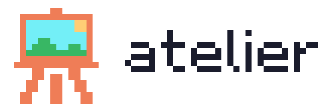
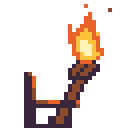

<p align="center">
  <picture>
    <source media="(prefers-color-scheme: dark)" srcset="assets/logo-wordmark-dark.png">
    
  </picture>
</p>

Atelier is an offline, headless pixel-art editor for command-line tools and AI
agents. Create layered sprites and animations, inspect pixels, and export PNGs,
spritesheets, GIFs, APNGs, and TrueType pixel fonts. Documents stay local.

Use it directly from a shell or connect an agent through MCP (Model Context
Protocol). Both interfaces expose the same editing tools; no graphical editor
or running server is needed for CLI calls.

<p align="center">
  
  
  
  
</p>

<p align="center">
  Drawn by an agent through Atelier's tools. Each is rebuilt byte for byte from
  the <a href="showcase/replays/opus-5.5-xhigh">recipe beside it</a> in CI.
</p>

## Showcase

- [Animation showcase](https://marmikshah.github.io/atelier/) — compare models and briefs, view animations, and download replays.
- [Frayed](https://apps.apple.com/app/id6806894761)

## Get started

Atelier builds from source on **Linux or macOS** with Rust 1.98+ and a native
build toolchain. A [container image](docs/running.md#container-image) is
published for MCP clients; no native binaries are.

```sh
cargo install --locked --git https://github.com/marmikshah/atelier atelier
atelier --help
```

To work from a checkout instead, which also pins the Rust version used for
development:

```sh
git clone https://github.com/marmikshah/atelier.git
cd atelier
cargo install --locked --path crates/atelier
```

Then follow [your first sprite](docs/getting-started.md) to create a document,
draw pixels, and save an image. `atelier uninstall` removes it again, keeping
your documents unless you ask otherwise.

| I want to… | Start here |
| --- | --- |
| Make art from the terminal | [Getting started](docs/getting-started.md) |
| Connect an agent, run a server, or choose where art is stored | [Running Atelier](docs/running.md) |
| Find a tool's arguments | `atelier tools --markdown` or `atelier tools --schema NAME` |
| Understand the code or work on the showcase | [Development guide](docs/development.md) |
| Report a bug or security issue | [Issues](https://github.com/marmikshah/atelier/issues) · [Security](.github/SECURITY.md) |

## Connect an agent

Agents with shell access can call `atelier call TOOL '<json>'` directly. For an
MCP client, register `atelier` as a stdio server with no arguments:

```json
{
  "mcpServers": {
    "atelier": {
      "command": "atelier",
      "env": { "ATELIER_HOME": "/absolute/path/to/your/art" }
    }
  }
}
```

In Claude Code, `claude mcp add atelier -e ATELIER_HOME=/absolute/path/to/your/art -- atelier`
registers the same server. Then run `atelier skills install --for claude`
(or `codex`, `cursor`, `all`) to give the agent the bundled drawing guides. [Running Atelier](docs/running.md)
covers HTTP, Docker, and storage.

## Stability

Atelier is at 0.1. `master` is the current source; releases are dispatched
from it and publish the container image, a `vX.Y.Z` tag, and the MCP Registry
entry.

- **Your documents are not discarded.** Edits are journaled and committed
  atomically. A document that is damaged, or saved by a build with a different
  document schema, is refused with an error and left unchanged on disk.
- **The document format is versioned, with no migration.** If an update
  changes it, documents saved before it are refused, stay on disk untouched,
  and open again with the commit that wrote them.
- **A recipe is the plain log of the calls that built a document**, one JSON
  line each. It has no version of its own: what it draws depends on how the
  tools behave, so a recipe from one commit replays exactly on commits whose
  tools draw the same way.
- **Tool names and arguments can still change** between commits. Pin a commit
  if you script against them, and read the current surface from
  `atelier tools --markdown`.

## How it is built

**100% of this code was written by AI.** Atelier began as an experiment in
whether agents, using only tool calls, can make art useful in games. My part
has been giving direction, and I hope the result helps you make something of
your own.

CI checks formatting, strict Clippy, and the Rust test suite on Linux and
macOS, smoke-tests the container, and replays every showcase recipe, which
must reproduce its GIF byte for byte. The [security policy](.github/SECURITY.md)
describes the network and file-access boundaries.

> [!NOTE]
> **None of the code has had line-by-line human review.** Bugs, security
> issues, and breaking changes are still possible. Please review the code and
> work with copies of important data before using it in production.

## Contributing

Bug reports and questions are welcome as issues; include the checkout commit and
a minimal command sequence or recipe file. Pull requests from outside the
project are not accepted. Report vulnerabilities privately through the
[security policy](.github/SECURITY.md).

[MIT](LICENSE) © Marmik Shah
